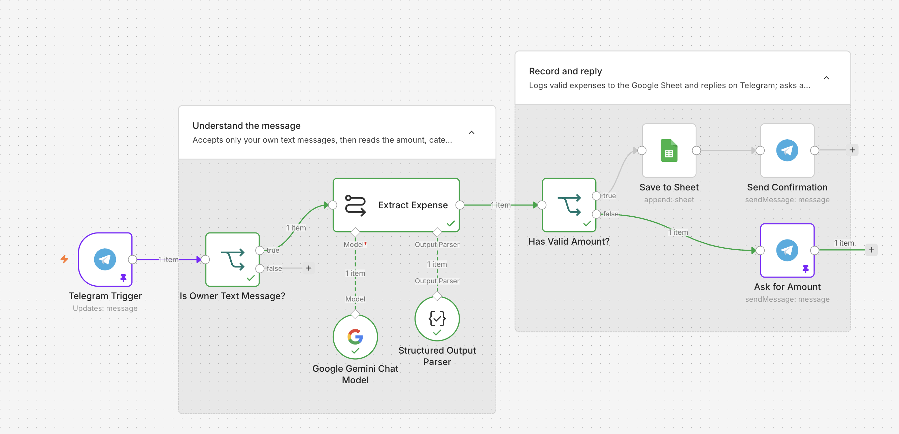

# n8n AI Expense Tracker (Telegram + Gemini + Google Sheets)

Send a message like `Lunch 850 at KFC` to a Telegram bot. An AI node turns the message into structured data (amount, category, merchant, date), n8n saves it to a Google Sheet, and the bot replies with a confirmation.

Built as a beginner-friendly n8n project for people learning how to use AI inside workflows.



## What it does

1. You send an expense in plain language to your Telegram bot.
2. The workflow checks that the message comes from **you** (your chat ID) and has text.
3. Google Gemini extracts the fields and returns clean JSON.
4. The workflow checks that the AI result is usable (valid and amount above 0).
5. Valid expenses are appended to Google Sheets and the bot confirms. Otherwise the bot asks you to try again.

```
Telegram Trigger -> IF (owner + text?) -> Extract expense (Gemini) -> IF (valid?) -> Save to sheet -> Confirm
                                                                          \-> (no) -> Ask to retry
```

## What you will learn

- Triggers and reading incoming data
- Branching with IF nodes
- Getting **structured JSON** from an AI node (system prompt + Structured Output Parser)
- **Validating AI output** instead of trusting it blindly
- Referencing earlier nodes, for example `$('Telegram Trigger')`
- Credentials and keeping secrets out of a repo

## Requirements

- An [n8n](https://n8n.io) account (Cloud or self-hosted)
- A Telegram account
- A Google account (for Google Sheets)
- A Gemini API key from [Google AI Studio](https://aistudio.google.com)

## Setup

### 1. Create the Telegram bot
1. In Telegram, open **@BotFather** and send `/newbot`.
2. Choose a name and a username ending in `bot`.
3. Copy the **bot token**. Keep it secret.
4. Open your new bot and press **Start**.

### 2. Get your chat ID
Open **@userinfobot** in Telegram and press Start. It replies with your numeric **Id**. This is what restricts the bot to you.

### 3. Create the Google Sheet
Create a sheet and type these headers in row 1, columns A to G:

| A | B | C | D | E | F | G |
|---|---|---|---|---|---|---|
| Date | Amount | Currency | Category | Merchant | Note | Raw message |

Select column A and set Format -> Number -> **Plain text** so dates are not converted.

### 4. Import the workflow
In n8n: **Create workflow** -> menu (top right) -> **Import from file** -> choose `workflows/01-capture-expenses.json`.

### 5. Connect credentials (inside n8n only)
- **Telegram**: create a credential with your bot token. Use it in every Telegram node.
- **Google Gemini**: create a credential with your API key. In the model node, pick a current Flash or Flash-Lite model from the dropdown.
- **Google Sheets**: create a credential with "Sign in with Google", then choose your sheet and tab.

### 6. Replace the placeholders
Search the workflow for `YOUR_TELEGRAM_CHAT_ID` and replace it with your numeric chat ID (the IF node and the Telegram send nodes). Select your own Document and Sheet in the Google Sheets node.

### 7. Test, then activate
1. Click **Execute workflow** and send `Lunch 850 at KFC` to your bot.
2. Check that a row appears in the sheet and the bot replies.
3. Toggle the workflow **Active**. Telegram allows one webhook per bot, so do not leave a test listener running at the same time.

## Try it

See [`sample-data/sample-messages.md`](sample-data/sample-messages.md) for messages to test, including ones that should be rejected.

## The AI prompt

The system prompt and the JSON example used by the Structured Output Parser are in [`prompts/expense-extraction.md`](prompts/expense-extraction.md).

## Troubleshooting

| Problem | Likely fix |
|---|---|
| Nothing arrives in n8n | Click **Execute workflow** before sending (test mode listens once), or make sure the workflow is **Active**. Only one active workflow can use the same bot. |
| Bot ignores you | The chat ID in the IF node must be your numeric ID and the operator must be **Number -> is equal to**. |
| Empty or wrong cells in the sheet | Check the expressions use `output.` (for example `{{ $json.output.amount }}`) and that the headers match exactly. |
| AI returns plain text, not JSON | Keep **Require Specific Output Format** on, the Structured Output Parser attached, and temperature at `0`. |
| "Model not found" | Pick a current model from the dropdown. Model names change. |
| Quota or rate-limit error | Free tiers have small limits. Wait and retry, or reduce test runs. |
| Dates turn into numbers | Set column A to **Plain text**. |

## Privacy and safety

- The bot only acts on messages from **your** chat ID. Never publish your bot token, chat ID, sheet ID or API keys.
- Free-tier AI prompts may be used by the provider to improve their products. Check the provider's current terms and avoid sending sensitive financial details.
- AI can misread messages. Check your sheet from time to time.
- This is a learning project, **not financial advice**.

## Variation: no Telegram?

If Telegram is not available to you, replace the Telegram Trigger with a **Webhook** node and the Telegram send nodes with **Respond to Webhook**. Everything in the middle stays the same.

| Telegram version | Webhook version |
|---|---|
| `{{ $json.message.text }}` | `{{ $json.body.message }}` |
| Chat ID check | Secret key check on `{{ $json.body.key }}` |
| Telegram send nodes | Respond to Webhook (text) |

## Ideas for next versions

- Weekly summary report (Schedule trigger + Code node + AI summary)
- Error alert workflow
- Multi-currency totals

## License

MIT. See [LICENSE](LICENSE).
